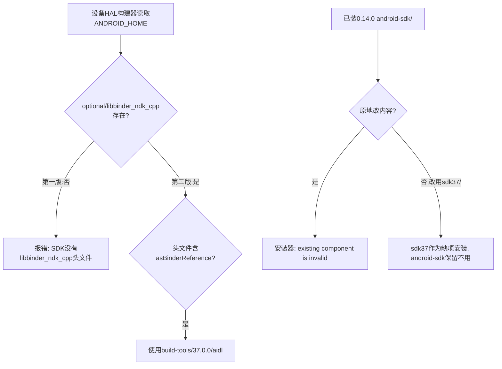

# Android SDK组件第二版

2026-09-26在[第一版](../android-sdk-v1/README.md)基础上补入`platforms/android-36/optional/libbinder_ndk_cpp`头文件，并把安装目录由`android-sdk/`改为`sdk37/`，版本为0.14.1。

## 原因

主仓把`ANDROID_HOME`指向本组件后，设备仓HAL构建器（如`devices/pixel6-15/tools/hal/lib/sdk-layout.js`与`devices/oneplusace6t-16/tools/hal/lib/sdk-layout.js`）会按标准SDK布局读取`platforms/android-<api>/optional/libbinder_ndk_cpp/android/binder_interface_utils.h`与`binder_auto_utils.h`，并按头文件是否含`asBinderReference`决定能否使用Build Tools 37的`aidl`。第一版只保留了`android.jar`，这些构建器会报`Android SDK has no libbinder_ndk_cpp headers`。头文件来自同一份官方`platform-36_r02.zip`，八个文件共148KB，三宿主字节相同；`binder_interface_utils.h`含`asBinderReference`，所以按规则可以使用37.0.0的`aidl`。NDK不在此组件内，设备构建器先读`ANDROID_NDK_HOME`等变量，主仓已导出本仓`ndk29/`。

安装器发现组件目录已存在但检查失败时，只报错，不删除也不覆盖。已按0.14.0安装过`android-sdk/`的宿主若原地改变内容，`toolchain-init`会失败。按本仓`go126/`、`jdk21/`、`ndk29/`等带版本目录的约定，组件改装到`sdk37/`：旧`android-sdk/`保留为不再引用的目录（与删除LLVM 19后留下的`llvm19/`相同），新目录作为缺项正常安装。归档内顶层目录仍为`android-sdk`（`Prefix`），因此只需重新打包一次，分片移到`payload/sdk37/`。



## 重现

头文件取自第一版展开的官方归档目录，逐个以0644复制到三个宿主的暂存树，目录0755：

```bash
cd tools/toolchains/prebuilts
src=build/android-sdk-unpack/platform-36_r02/android-36/optional/libbinder_ndk_cpp
for h in darwin-arm64 linux-arm64 linux-amd64; do
  d=build/android-sdk-stage/$h/android-sdk/platforms/android-36/optional
  install -d -m 0755 "$d/libbinder_ndk_cpp/android"
  for f in "$src"/android/*.h; do install -m 0644 "$f" "$d/libbinder_ndk_cpp/android/"; done
done
for h in darwin-arm64 linux-arm64 linux-amd64; do
  docker run --rm --network=none --user $(id -u):$(id -g) -v "$PWD/build:/w" ubuntu:26.04 sh -c \
    "cd /w/android-sdk-stage/$h && tar --sort=name --mtime=@0 --owner=0 --group=0 --numeric-owner --format=gnu -cf - android-sdk | gzip -n -9 > /w/android-sdk-out/android-sdk-37.0.0-android-36-r2-$h.tar.gz"
done
```

三份归档分别为46441963（darwin-arm64）、47392895（linux-arm64）、46797668（linux-amd64）字节，各一个普通Git分片；摘要、头文件来源摘要与归档条目见[sources.log](sources.log)，打包输出见[pack.log](pack.log)。

## 测试

- 红灯：三个`androidsdk.go`先加入两个头文件的身份检查（大小、SHA-256，并分别要求含`asBinderReference`与`class SpAIBinder`），仍用第一版分片。`TestAndroidSDK`在macOS arm64本机、Ubuntu 26.04 arm64原生容器与NUC的Ubuntu 24.04 x86_64原生环境均以`invalid identity file ... binder_interface_utils.h: no such file or directory`退出1（`*-red.log`）。红灯在改目录名之前运行，只证明缺少头文件。
- 绿灯：换入新分片、更新摘要并改为`sdk37`后，三宿主`go vet ./...`退出0；`./cmd/...`、`./internal/...`与`TestCatalog`、`TestAndroidSDK`全部通过（`darwin-arm64-full.log`、`*-green.log`）。`TestAndroidSDK`仍用正式安装实现展开JDK 21与`sdk37`并执行完整检查，再完成AIDL、资源、DEX、对齐、签名和回读。
- 完整`tests`包的已知下标问题与第一版记录相同，本版未改变。

## 安装

三个`bin/cdh-toolchain`以Go 1.26.8、`CGO_ENABLED=0`、`-trimpath`、`-buildvcs=false`、`-ldflags='-s -w'`重建（[installer-format.log](installer-format.log)）。新macOS安装器对主仓正式`output/toolchains/darwin-arm64/`执行`install`：七个既有组件`skipped`，Android SDK `installed`到`sdk37/`，退出0；随后`check`退出0（`darwin-arm64-install.log`、`darwin-arm64-check.log`）。在改目录名前，0.14.1候选安装器对已有`android-sdk/`返回`existing component Android SDK is invalid`，正是改用新目录的直接依据。
